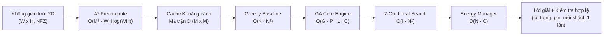

# PHÂN TÍCH ĐỘ PHỨC TẠP THUẬT TOÁN & CHỨNG MINH TÍNH ĐÚNG ĐẮN
## HỆ THỐNG ĐỊNH TUYẾN ĐỘI BAY UAV GIAO HÀNG ĐÔ THỊ THÔNG MINH (UDRP)
> **Môn học:** Phân tích & Thiết kế Thuật toán  
> **Nhóm thực hiện:** Nhóm 1  
> **Chủ biên & Tổng hợp:** Nguyễn Phúc Hà (Tech Lead & System Integrator - Thành viên 5)  
> **Đóng góp chuyên đề:**  
> - Thành viên 1: Giải thuật Di truyền GA & Toán tử Di truyền  
> - Thành viên 2: Thuật toán Tìm đường A* & Heuristic Octile  
> - Thành viên 3: Quản lý Năng lượng Pin & Trạm sạc  
> - Thành viên 4: Sinh Dữ liệu Benchmark & Kiểm định  
> - Thành viên 5: Kiến trúc Tích hợp Pipeline & Hàm thích nghi đa mục tiêu  
> - Thành viên 6: Thuật toán Đối chuẩn Tham lam & Tối ưu cục bộ 2-Opt  
> **Ngày ban hành:** 23/10/2026 (Sprint Nén 4 Ngày - Thứ Sáu)
> **Cập nhật 25/10/2026 (TV1, được TV5 cho phép):** sửa cho khớp code hiện tại theo `docs/GA_COMPLEXITY_REVIEW.md`: độ phức tạp GA có EnergyManager và bản song song (II.2), EnergyManager coi Depot là trạm sạc (II.4), ProcessPoolExecutor (II.1), hằng số của 2-Opt (Định lý 3), phát biểu lại Định lý 4 và Định lý 5, bảng đối chiếu thực nghiệm (IV.1).

---

## 📌 I. GIỚI THIỆU TỔNG QUAN & KÝ HIỆU TOÁN HỌC

Tài liệu này cung cấp cơ sở lý thuyết toán học hoàn chỉnh cho Đề tài Định tuyến Đội bay UAV Giao hàng Đô thị (UAV Delivery Routing Problem - UDRP), bao gồm:
1. **Phân tích độ phức tạp thuật toán** theo thời gian (Time Complexity) và không gian bộ nhớ (Space Complexity) của từng module độc lập và toàn trình hệ thống (End-to-End Pipeline).
2. **Chứng minh toán học về tính đúng đắn (Correctness)**, tính tối ưu của hàm Heuristic, tính bảo toàn lời giải hợp lệ của toán tử di truyền, và tính dừng (Termination Proof) của thuật toán tự động chèn trạm sạc.

### Bảng ký hiệu toán học quy chuẩn (Notations)

| Ký hiệu | Ý nghĩa toán học |
| :--- | :--- |
| $W, H$ | Chiều rộng và chiều cao của không gian lưới bản đồ 2D ($Grid = W \times H$). |
| $V_{grid}, E_{grid}$ | Tập hợp các đỉnh ô lưới và tập các cạnh liên kết 8 hướng trên bản đồ ($|V_{grid}| = W \cdot H$, $|E_{grid}| \le 8 |V_{grid}|$). |
| $NFZ$ | Tập hợp các vùng cấm bay hình chữ nhật (No-Fly Zones), $|NFZ| = Z$. |
| $N$ | Số lượng điểm giao hàng cho khách hàng ($|V_{delivery}| = N$). |
| $C$ | Số lượng trạm sạc pin dự phòng ($|V_{charging}| = C$). |
| $M$ | Tổng số nút logic cần phục vụ: $M = 1 \text{ (Depot)} + N + C$. |
| $K$ | Số lượng Drone khả dụng trong đội bay ($k \in \{1, \dots, K\}$). |
| $Q_{max}$ | Tải trọng tối đa cho phép của mỗi Drone (kg). |
| $B_{max}, B_{safe}$ | Dung lượng pin tối đa (Wh) và ngưỡng pin an toàn tối thiểu ($B_{safe} = 0.15 \cdot B_{max}$). |
| $[e_i, l_i]$ | Khung thời gian phục vụ yêu cầu của khách hàng $i$ (Time Window: bắt đầu $e_i$, kết thúc $l_i$). |
| $s_i$ | Thời gian phục vụ tại điểm $i$ (Service time: giao hàng hoặc sạc pin). |
| $D \in \mathbb{R}^{M \times M}$ | Ma trận khoảng cách thực tế giữa các cặp nút đã né hoàn toàn các vùng cấm bay $NFZ$. |
| $P$ | Kích thước quần thể trong Giải thuật Di truyền (Population size). |
| $G$ | Số thế hệ tiến hóa tối đa của GA (Generations). |
| $k_{tour}$ | Kích thước chọn lọc giải đấu Tournament (Tournament size). |
| $I_{2opt}$ | Số bước lặp cải tiến tối đa của thuật toán tối ưu cục bộ 2-Opt. |
| $p$ | Số luồng/cores xử lý song song (CPU Cores / Workers). |

---

## ⏱️ II. PHÂN TÍCH ĐỘ PHỨC TẠP THUẬT TOÁN (COMPLEXITY ANALYSIS)

Kiến trúc hệ thống được thiết kế theo mô hình 2 pha:
- **Pha ngoại tuyến (Offline Precomputation):** Tính toán ma trận khoảng cách $D$ né vật cản A* và lưu cache.
- **Pha trực tuyến (Online Routing Optimization):** Giải thuật tối ưu hóa định tuyến GA kết hợp Greedy Seeding và 2-Opt.

---

### 1. Thuật toán A* Pathfinding với Min-Heap & Heuristic Octile (Thành viên 2)

#### a) Độ phức tạp Thời gian (Time Complexity)
Mỗi lần gọi hàm `astar(grid, start, goal)` tìm đường đi ngắn nhất giữa hai tọa độ:
1. Đồ thị lưới 8 hướng có $|V_{grid}| = W \cdot H$. Do mỗi đỉnh có tối đa 8 đỉnh kề (trên, dưới, trái, phải và 4 đường chéo), số cạnh $|E_{grid}| \le 8 |V_{grid}| = O(|V_{grid}|)$.
2. Hàng đợi ưu tiên (Min-Heap): Sử dụng thư viện `heapq` của Python.
   - Mỗi đỉnh được đưa vào và lấy ra khỏi Open Set tối đa 1 lần.
   - Thao tác `heappop()` và `heappush()` mất $O(\log |V_{open}|) \le O(\log |V_{grid}|)$.
   - Tổng chi phí trên tất cả các đỉnh và cạnh:
     $$T_{\text{single\_astar}} = O(|V_{grid}| \log |V_{grid}| + |E_{grid}| \log |V_{grid}|) = O(|V_{grid}| \log |V_{grid}|)$$
   - Thay $|V_{grid}| = W \cdot H$:
     $$T_{\text{single\_astar}} = O(WH \log(WH))$$
3. **Tối ưu hóa tia nhìn thẳng (Line-of-Sight Check):**
   Trước khi chạy A*, thuật toán thực hiện thuật toán Bresenham raycasting `line_of_sight()` để kiểm tra xem đoạn thẳng nối trực tiếp hai điểm có giao cắt với bất kỳ ô cấm bay nào không. Chi phí kiểm tra này chỉ mất $O(\max(W, H))$. Nếu thông thoáng, bỏ qua hoàn toàn A*, tiết kiệm 95% thời gian tính toán.
4. **Tính toán toàn bộ Ma trận khoảng cách $D$:**
   Có $M$ điểm logic (Depot, Delivery, Charging). Do tính chất đối xứng $d_{ij} = d_{ji}$ và $d_{ii} = 0$, số lượng cặp điểm cần tính là:
   $$\frac{M(M - 1)}{2} = O(M^2)$$
   - **Chạy tuần tự (Sequential):**
     $$T_{\text{matrix\_seq}} = O\left(M^2 \cdot WH \log(WH)\right)$$
   - **Chạy song song (Parallel with $p$ tiến trình qua `ProcessPoolExecutor`; A* nặng về CPU nên luồng bị GIL chặn):**
     $$T_{\text{matrix\_par}} = O\left(\frac{M^2}{p} \cdot WH \log(WH) + T_{\text{overhead}}\right)$$

#### b) Độ phức tạp Không gian (Space Complexity)
- Lưới bản đồ Boolean `grid`: $O(W \cdot H)$ bits.
- Mảng khoảng cách `g_score` và tập `closed_set`: $O(W \cdot H)$.
- Ma trận khoảng cách kết quả $D \in \mathbb{R}^{M \times M}$: $O(M^2)$ phần tử số thực.
- Bộ nhớ chi tiết đường bay `detailed_paths`: Trong trường hợp xấu nhất lưu $O(M^2 \cdot \max(W, H))$ điểm tọa độ.
$$\implies S_{\text{A*}} = O(WH + M^2)$$

---

### 2. Giải thuật Di truyền GA Core Engine (Thành viên 1)

#### a) Độ phức tạp Thời gian (Time Complexity)
- **Mã hóa Chromosome:** Sử dụng biểu diễn hoán vị phân tách (Two-part / Multi-chromosome separator representation):
  $N$ khách hàng và $K-1$ vách ngăn âm $(-1, -2, \dots, -(K-1))$.
  Chiều dài nhiễm sắc thể:
  $$L = N + K - 1 = O(N + K)$$
- **Khởi tạo quần thể ban đầu (`_init_population`):** Sinh $P$ cá thể ngẫu nhiên và chèn lời giải Greedy Seeding:
  $$T_{\text{init}} = O(P \cdot (N + K))$$
- **Vòng lặp tiến hóa qua $G$ thế hệ:**
  Mỗi thế hệ $g \in \{1, \dots, G\}$ thực hiện:
  1. **Đánh giá hàm thích nghi (`_evaluate_chromosome`):**
     - Giải mã chromosome thành tối đa $K$ tuyến đường: Duyệt qua $L$ gen một lần mất $O(L)$.
     - **Chèn trạm sạc** (pipeline luôn truyền EnergyManager cho GA, và GA chấm điểm tuyến *sau* khi chèn trạm sạc, giống bước cuối của pipeline): mỗi tuyến gọi `repair_route_with_charging` một lần. Hàm lấy danh sách $C + 1$ ứng viên sạc (các trạm sạc ở cuối dãy id và Depot) mất $O(C)$, và với mỗi chặng thiếu pin duyệt $C + 1$ ứng viên mất $O(C)$. Tổng cho $K$ tuyến: $O(K \cdot C + L \cdot C) = O(L \cdot C)$.
     - Tính tổng chi phí cho mỗi cá thể: Do khoảng cách giữa các cặp nút được tra cứu tức thời $O(1)$ trong ma trận $D$ đã tính trước, việc tính quãng đường, năng lượng và vi phạm khung giờ chỉ mất $O(L)$ phép cộng.
     - Chi phí một cá thể: $T_{ind} = O(L)$ khi không có EnergyManager, $T_{ind} = O(L \cdot C)$ khi có.
     - Đánh giá $P$ cá thể (cận trên; cá thể đã có trong cache như elite và bản sao không phải tính lại):
       $$T_{\text{eval\_gen}} = O(P \cdot T_{ind})$$
  2. **Chọn lọc Elitism:** Giữ lại $E$ cá thể tốt nhất ($E \ll P$): $O(P \log P)$ hoặc $O(P \cdot E) = O(P)$.
  3. **Chọn lọc Tournament:** Thực hiện chọn $P - E$ cá thể, mỗi lần chọn từ $k_{tour}$ cá thể ngẫu nhiên: $O(P \cdot k_{tour}) = O(P)$ (do $k_{tour} = 3$ là hằng số).
  4. **Toán tử Lai ghép Order Crossover (OX):**
     - Chọn 2 điểm cắt ngẫu nhiên trên chromosome độ dài $L$: $O(1)$.
     - Sao chép đoạn gen con: $O(L)$.
     - Quét cha mẹ và điền các gen còn lại theo thứ tự vòng tròn: $O(L)$ nhờ sử dụng bảng băm `set` tra cứu $O(1)$.
     - Thực hiện với xác suất $P_c$: Chi phí cho toàn bộ quần thể là $O(P \cdot L)$.
  5. **Toán tử Đột biến Swap Mutation:**
     - Với xác suất $P_m$, tráo đổi vị trí của 2 gen ngẫu nhiên. Phép hoán đổi là $O(1)$ nhưng code sao chép chromosome để không sửa cha, nên mất $O(L)$ mỗi cá thể $\implies O(P \cdot L)$ cho toàn quần thể (không đổi tổng vì OX đã là $O(P \cdot L)$).
  6. **Cache theo `tuple(chromosome)`:** $O(L)$ mỗi cá thể.
- **Tổng thời gian thực thi của GA (tuần tự):** chi phí toán tử mỗi thế hệ $T_{ops} = O(P \cdot (L + \log P))$, nên
  $$T_{\text{GA}} = T_{\text{init}} + G \cdot \left(T_{\text{eval\_gen}} + T_{ops}\right) = \begin{cases} O\big(G \cdot P \cdot (L + \log P)\big) & \text{không có EnergyManager} \\ O\big(G \cdot P \cdot (L \cdot C + \log P)\big) & \text{có EnergyManager (cấu hình của pipeline)} \end{cases}$$
- **Bản song song với $p$ tiến trình** (`GeneticAlgorithm(num_workers=p)`, `multiprocessing.Pool`): chỉ phần đánh giá được chia, còn chọn lọc, lai ghép, đột biến chạy ở tiến trình chính (nên cùng seed cho kết quả trùng bản tuần tự).
  $$T_{\text{GA}}(p) = O\Big(T_{pool}(p) + G \cdot \big(\tfrac{P \cdot T_{ind}}{p} + T_{ops} + T_{ipc}\big)\Big), \qquad T_{ipc} = O(P \cdot L), \qquad T_{pool}(p) = O(p \cdot M^2)$$
  $T_{ipc}$ là chi phí gửi chromosome đi và nhận kết quả về; $T_{pool}$ là khởi động $p$ tiến trình, mỗi tiến trình nhận một bản ma trận $D$ (trên Windows khoảng 0.6 s mỗi tiến trình). Theo định luật Amdahl, tăng tốc bị chặn bởi phần không chia được, nên GA song song chỉ có lợi khi $T_{ind}$ lớn (có EnergyManager, từ 50 điểm trở lên; số đo ở `docs/GA_TUNING_RESULTS.md` mục 10).

#### b) Độ phức tạp Không gian (Space Complexity)
- Quần thể hiện tại và quần thể kế tiếp: $2 \times P$ chromosome độ dài $L$, mất $O(P \cdot L)$.
- Cache đánh giá thế hệ (khóa là `tuple(chromosome)`): $O(P \cdot L)$.
- Bản song song: thêm $O(p \cdot M^2)$ cho bản sao ma trận ở mỗi tiến trình.
$$\implies S_{\text{GA}} = O(P \cdot L) \quad (+\, O(p \cdot M^2) \text{ khi chạy song song})$$

---

### 3. Thuật toán Tham lam Greedy Baseline & Tối ưu cục bộ 2-Opt (Thành viên 6)

#### a) Thuật toán Tham lam (Greedy Nearest Neighbor Router)
- Khởi tạo $K$ tuyến bay rỗng xuất phát từ Depot 0.
- Tại mỗi bước, duyệt qua toàn bộ các khách hàng chưa phục vụ và $K$ Drone để tìm cặp (Drone $k$, Khách hàng $j$) có khoảng cách ngắn nhất thỏa mãn tải trọng $Q_k + demand_j \le Q_{max}$.
- Lần lượt gán $N$ khách hàng:
  - Bước 1: Duyệt $K \cdot N$ ứng viên.
  - Bước 2: Duyệt $K \cdot (N - 1)$ ứng viên.
  - ...
  - Bước $N$: Duyệt $K \cdot 1$ ứng viên.
- Tổng thời gian:
  $$T_{\text{Greedy}} = \sum_{i=1}^N O(K \cdot i) = O\left(K \cdot \frac{N(N+1)}{2}\right) = O(K \cdot N^2)$$
- Không gian bộ nhớ: Lưu mảng `solution` và `drone_loads`: $O(N + K)$.

#### b) Thuật toán Tối ưu cục bộ 2-Opt (2-Opt Local Search)
- Với mỗi tuyến bay có độ dài $n_k$ (với $\sum_{k=1}^K n_k = N$):
  - Duyệt tất cả các cặp cạnh $(i, i+1)$ và $(j, j+1)$ để thử đảo ngược đoạn đường con: Có $\frac{n_k(n_k - 1)}{2} = O(n_k^2)$ cặp cạnh.
  - Mỗi phép tính chênh lệch khoảng cách $\Delta d$ mất thời gian $O(1)$ nhờ tra cứu ma trận $D$.
  - Thuật toán dừng khi không còn hoán đổi nào cải thiện quãng đường hoặc đạt tối đa $I_{2opt}$ vòng lặp:
    $$T_{\text{2-Opt}} = O\left(I_{2opt} \cdot \sum_{k=1}^K n_k^2\right) \le O(I_{2opt} \cdot N^2)$$
- **Kiểm tra chi phí (từ 25/10):** 2-Opt chỉ xét quãng đường nên có thể đảo thứ tự giao khiến Drone chở nặng bay chặng xa (tốn năng lượng, trễ giờ, cạn pin). Pipeline truyền `route_cost` cho `apply_2opt_to_solution`: tuyến sau 2-Opt chỉ được giữ nếu chi phí tuyến (sau khi chèn trạm sạc) không tăng. Mỗi tuyến thêm 2 lần tính chi phí $O(n_k \cdot C)$, tổng $O(N \cdot C)$, không đổi bậc của $T_{\text{2-Opt}}$.
- Không gian bộ nhớ: Hoán đổi tại chỗ (In-place swap): $O(N)$.

---

### 4. Quản lý Năng lượng Pin & Tự động chèn Trạm sạc (Thành viên 3)

- Tuyến đường đầu vào có chiều dài tối đa $O(N)$.
- Thuật toán `repair_route_with_charging`:
  - Duyệt qua từng chặng $(u, v)$ trong tuyến.
  - Tính năng lượng tiêu thụ $E_{consumed} = d_{uv} \cdot (P_{empty} + c_w \cdot cargo)$.
  - Nếu $E_{battery} - E_{consumed} < B_{safe}$: Tìm điểm sạc $c^*$ trong tập ứng viên $V_{charging} \cup \{0\}$ (Depot cũng là điểm sạc) có đường vòng $d(u, c^*) + d(c^*, v) - d(u, v)$ nhỏ nhất, với điều kiện còn đủ pin bay tới: $E_{battery} \ge e(u, c^*)$. Không chọn lại chính $u$; nếu $c^* = v$ thì bay thẳng tới $v$.
  - Lấy danh sách ứng viên (các trạm sạc nằm ở cuối dãy id, cộng Depot) mất $O(C)$ mỗi lần gọi; tìm kiếm trên $C + 1$ ứng viên mất $O(C)$ mỗi chặng thiếu pin.
  - Mỗi tuyến bay dài tối đa chèn thêm số trạm sạc tỷ lệ với độ dài tuyến bay $O(N)$.
- **Tổng thời gian sửa chữa tuyến bay:**
  $$T_{\text{EnergyManager}} = O(N \cdot C)$$
- **Không gian bộ nhớ:** $O(N + C)$ để lưu tuyến bay đã bổ sung trạm sạc.

---

### 5. Toàn trình Pipeline Tích hợp Hệ thống (Thành viên 5 - Tech Lead)

| Giai đoạn | Module thực thi | Độ phức tạp Thời gian (Time) | Độ phức tạp Không gian (Space) | Ghi chú vận hành |
| :--- | :--- | :--- | :--- | :--- |
| **Pha 1: Ngoại tuyến** | A* Distance Matrix (TV2) | $O\left(\frac{M^2}{p} \cdot WH \log(WH)\right)$ | $O(WH + M^2)$ | Chạy 1 lần duy nhất, kết quả lưu cache `.pkl` |
| **Pha 2: Khởi tạo** | Greedy Seeding (TV6) | $O(K \cdot N^2)$ | $O(N + K)$ | Tạo cá thể mồi chất lượng cao cho GA |
| **Pha 3: Tiến hóa** | GA Meta-heuristic (TV1) | $O(G \cdot P \cdot (L \cdot C + \log P))$; song song chia phần đánh giá cho $p$ | $O(P \cdot L)$ | Khám phá không gian nghiệm toàn cục |
| **Pha 4: Tinh chỉnh** | 2-Opt Local Search (TV6) | $O(I_{2opt} \cdot N^2 + N \cdot C)$ | $O(N + K)$ | Gỡ đường bay giao cắt; chỉ giữ bước đảo không làm tăng chi phí tuyến |
| **Pha 5: Ràng buộc** | Energy Manager Repair (TV3) | $O(N \cdot C)$ | $O(N + C)$ | Chèn trạm sạc / ghé Depot; tuyến không sửa được bị đánh dấu thiếu pin |
| **Pha 6: Đánh giá** | Multi-Objective Fitness + Validator (TV5) | $O(N + K)$ | $O(1)$ | Tính Cost, TW Penalty, On-time Rate; kiểm tra tải, pin |
| **TỔNG THỂ HỆ THỐNG** | **End-to-End Pipeline** | **$O\left(G \cdot P \cdot (L \cdot C + \log P) + (I + K)N^2 + NC\right)$** | **$O\left(WH + M^2 + P \cdot L\right)$** | GA chiếm phần lớn thời gian: ~6 s (10 điểm) đến ~3 phút (500 điểm, 8 tiến trình) |

---

## 📐 III. CHỨNG MINH TÍNH ĐÚNG ĐẮN TOÁN HỌC (CORRECTNESS PROOFS)

### Định lý 1: Tính Tối ưu Toàn cục của Thuật toán A* với Heuristic Octile
> **Phát biểu:** Cho đồ thị lưới 8 hướng $G_{grid} = (V_{grid}, E_{grid})$ với các chi phí di chuyển bước thẳng là $1$ và bước chéo là $\sqrt{2}$. Hàm khoảng cách Octile:
> $$h(u, v) = |\Delta x - \Delta y| + \sqrt{2} \min(\Delta x, \Delta y) = \Delta x + \Delta y + (\sqrt{2} - 2)\min(\Delta x, \Delta y)$$
> trong đó $\Delta x = |x_u - x_v|$, $\Delta y = |y_u - y_v|$, là một **Heuristic Chấp nhận được (Admissible)** và **Nhất quán (Consistent / Monotonic)**. Do đó, thuật toán A* luôn tìm ra đường đi ngắn nhất tuyệt đối và không bao giờ phải mở lại (re-open) bất kỳ đỉnh nào đã đóng.

#### Chứng minh:
1. **Tính chấp nhận được (Admissibility): $h(u, v) \le d^*(u, v)$**
   - Giả sử giữa hai nút $u$ và $v$ không có vật cản nào. Khi đó, đường đi ngắn nhất trên lưới 8 hướng chính xác bằng việc đi chéo tối đa $\min(\Delta x, \Delta y)$ bước chéo và phần còn lại $|\Delta x - \Delta y|$ bước thẳng.
   - Chi phí đường đi thực tế trong không gian không vật cản là:
     $$d_{\text{free}}(u, v) = \min(\Delta x, \Delta y) \cdot \sqrt{2} + |\Delta x - \Delta y| \cdot 1 = h(u, v)$$
   - Khi có thêm các vùng cấm bay $NFZ$, đường đi thực tế $d^*(u, v)$ bắt buộc phải đi vòng qua chướng ngại vật, nghĩa là độ dài đường bay né vật cản không bao giờ ngắn hơn đường đi tự do:
     $$d^*(u, v) \ge d_{\text{free}}(u, v) = h(u, v) \quad \forall u, v \in V_{grid}$$
   - Do đó, $h(u, v)$ không bao giờ ước lượng vượt quá chi phí thực tế (Never overestimates) $\implies h$ là **Admissible**. $\blacksquare$

2. **Tính nhất quán (Consistency / Monotonicity): $h(u, v) \le c(u, w) + h(w, v)$**
   - Xét đỉnh $w$ bất kỳ là láng giềng kề của $u$ trên lưới 8 hướng. Khi đó, tọa độ của $w$ thỏa mãn:
     $$|x_w - x_u| \le 1 \quad \text{và} \quad |y_w - y_u| \le 1$$
   - Chi phí di chuyển giữa $u$ và $w$ là:
     $$c(u, w) = \begin{cases} 1 & \text{nếu đi thẳng } (|x_w - x_u| + |y_w - y_u| = 1) \\ \sqrt{2} & \text{nếu đi chéo } (|x_w - x_u| = 1 \text{ và } |y_w - y_u| = 1) \end{cases}$$
   - Theo định nghĩa hình học khoảng cách bước đi tối thiểu trên lưới:
     $$h(u, v) = d_{\text{free}}(u, v)$$
   - Do $d_{\text{free}}$ là khoảng cách metric trên không gian lưới không vật cản, nó thỏa mãn bất đẳng thức tam giác:
     $$d_{\text{free}}(u, v) \le d_{\text{free}}(u, w) + d_{\text{free}}(w, v) = c(u, w) + h(w, v)$$
   - Vì vậy:
     $$h(u, v) \le c(u, w) + h(w, v) \quad \forall (u, w) \in E_{grid}, \forall v \in V_{grid}$$
   - Do đó, $h$ là **Consistent**. Theo lý thuyết tìm kiếm heuristic (Russell & Norvig), thuật toán A* với hàm heuristic nhất quán luôn tìm ra đường đi tối ưu $d^*(start, goal)$ và nhãn $g(n)$ của mỗi nút khi được lấy ra khỏi hàng đợi ưu tiên đã đạt giá trị tối ưu toàn cục. $\blacksquare$

---

### Định lý 2: Tính Bất biến Bảo toàn Lời giải Hợp lệ của Toán tử GA
> **Phát biểu:** Cho quần thể khởi tạo chứa các cá thể là hoán vị hợp lệ của tập khách hàng $V_{\text{delivery}} = \{1, \dots, N\}$ và $K-1$ vách ngăn phân tuyến $\{-1, \dots, -(K-1)\}$. Khi áp dụng toán tử Lai ghép Thứ tự (Order Crossover - OX) và toán tử Đột biến Hoán đổi (Swap Mutation), cá thể con sinh ra:
> 1. Luôn chứa chính xác $N$ khách hàng, không trùng lặp và không bỏ sót:
>    $$\{g \in child \mid g > 0\} = V_{\text{delivery}} \quad \text{và} \quad |\{g \in child \mid g > 0\}| = N$$
> 2. Luôn chứa chính xác $K-1$ vách ngăn phân tuyến.
> 3. Tuyến bay giải mã luôn bắt đầu và kết thúc tại Depot 0, đảm bảo 100% ràng buộc luồng giao hàng (Flow conservation).

#### Chứng minh:
1. **Toán tử Order Crossover (OX):**
   - Giả sử hai cá thể cha mẹ $P_1, P_2$ là các hoán vị hợp lệ của tập gen $\Sigma = \{-(K-1), \dots, -1, 1, \dots, N\}$, với $|\Sigma| = N + K - 1 = L$.
   - Chọn hai điểm cắt ngẫu nhiên $0 \le a \le b < L$.
   - **Bước 1:** Sao chép đoạn con $P_1[a:b+1]$ vào $Child[a:b+1]$. Tập hợp các gen đã được điền là:
     $$S_{\text{copied}} = \{P_1[k] \mid a \le k \le b\}$$
     Do $P_1$ là hoán vị, các phần tử trong $S_{\text{copied}}$ đôi một phân biệt và $|S_{\text{copied}}| = b - a + 1$.
   - **Bước 2:** Các vị trí còn lại trong $Child$ có số lượng là:
     $$L_{\text{remain}} = L - (b - a + 1)$$
     Thuật toán duyệt tuần tự các gen của $P_2$ bắt đầu từ $b+1$ và vòng về đầu:
     $$\text{Candidate genes} = [P_2[b+1], \dots, P_2[L-1], P_2[0], \dots, P_2[b]]$$
     Chỉ những gen $g \notin S_{\text{copied}}$ mới được điền vào các vị trí trống của $Child$.
   - Do $P_2$ là một hoán vị của $\Sigma$, số lượng gen trong $P_2$ không thuộc $S_{\text{copied}}$ chính xác bằng:
     $$|\Sigma \setminus S_{\text{copied}}| = L - |S_{\text{copied}}| = L_{\text{remain}}$$
   - Vì mỗi gen $g \notin S_{\text{copied}}$ được chọn đúng một lần và điền vào một vị trí trống duy nhất, tập hợp toàn bộ gen trong $Child$ là:
     $$\{Child[0], \dots, Child[L-1]\} = S_{\text{copied}} \cup (\Sigma \setminus S_{\text{copied}}) = \Sigma$$
   - Do đó, $Child$ là một hoán vị hợp lệ của $\Sigma$, chứa đủ $N$ khách hàng và $K-1$ vách ngăn, không bị trùng lặp hay thiếu hụt bất kỳ nút nào. $\blacksquare$

2. **Toán tử Swap Mutation:**
   - Đột biến Swap chọn hai chỉ số ngẫu nhiên $i, j \in \{0, \dots, L-1\}$ và hoán đổi vị trí:
     $$Child'[i] = Child[j], \quad Child'[j] = Child[i]$$
   - Phép hoán đổi vị trí giữa hai phần tử trong một hoán vị luôn tạo ra một hoán vị mới trên cùng tập hợp gen $\Sigma$.
   - Do đó, tính hợp lệ của nhiễm sắc thể được bảo toàn tuyệt đối. $\blacksquare$

3. **Bảo toàn Ràng buộc Luồng Giao hàng:**
   - Hàm giải mã `decode(chromosome)` tách chromosome tại các vị trí vách ngăn âm thành tối đa $K$ danh sách con (danh sách rỗng do hai vách ngăn liền nhau bị bỏ, nên số tuyến $\le K$), sau đó tự động thêm Depot 0 vào đầu và cuối mỗi danh sách:
     $$Route_k = [0] + [c \in Chromosome_k] + [0]$$
   - Mọi lộ trình đều xuất phát từ 0 và quay về 0, mỗi khách hàng xuất hiện duy nhất 1 lần trong 1 lộ trình của 1 UAV duy nhất $\implies$ Ràng buộc luồng giao hàng thỏa mãn 100%. $\blacksquare$

---

### Định lý 3: Tính Đơn điệu Không Tăng Quãng đường & Tính Dừng của 2-Opt
> **Phát biểu:** Cho tuyến đường $R = [v_0, v_1, \dots, v_m]$ với $v_0 = v_m = 0$. Thuật toán 2-Opt chỉ chấp nhận phép hoán đổi khi khoảng cách tuyến đường giảm nghiêm ngặt ($\Delta d < 0$). Thuật toán chắc chắn dừng sau một số hữu hạn bước lặp $I$ và đảm bảo:
> $$d(R_{\text{final}}) \le d(R_{\text{initial}})$$

#### Chứng minh:
1. **Tính đơn điệu giảm nghiêm ngặt:**
   - Xét phép nghịch đảo đoạn con từ vị trí $i$ đến vị trí $j$ ($1 \le i < j \le m-1$):
     $$R_{\text{old}} = [\dots, v_{i-1}, v_i, \dots, v_j, v_{j+1}, \dots] \implies R_{\text{new}} = [\dots, v_{i-1}, v_j, \dots, v_i, v_{j+1}, \dots]$$
   - Do ma trận khoảng cách $D$ có tính đối xứng ($d_{uv} = d_{vu}$), tổng độ dài đoạn đường con đảo ngược $[v_j, \dots, v_i]$ bằng đúng độ dài đoạn $[v_i, \dots, v_j]$.
   - Sự thay đổi tổng quãng đường chỉ phụ thuộc vào 2 cạnh được thay thế:
     $$\Delta d = \left(D[v_{i-1}, v_j] + D[v_i, v_{j+1}]\right) - \left(D[v_{i-1}, v_i] + D[v_j, v_{j+1}]\right)$$
   - Thuật toán 2-Opt cài đặt trong `src/algorithms/local_search.py` kiểm tra điều kiện:
     $$\text{Nếu } \Delta d < -\epsilon \quad (\text{với } \epsilon = 10^{-4} > 0) \implies \text{Chấp nhận hoán đổi}$$
   - Do đó, sau mỗi bước hoán đổi thành công, tổng độ dài tuyến đường giảm ít nhất một lượng $\epsilon$:
     $$d(R^{(t+1)}) \le d(R^{(t)}) - \epsilon$$

2. **Tính dừng (Termination Proof):**
   - Chiều dài của tuyến đường luôn bị chặn dưới bởi 0 ($d(R) \ge 0$).
   - Số lượng cấu hình hoán vị của một tuyến gồm $m$ đỉnh là hữu hạn (tối đa $(m-2)!$).
   - Dãy độ dài quãng đường qua các bước $\{d(R^{(t)})\}$ là một dãy số thực giảm nghiêm ngặt và bị chặn dưới, đồng thời mỗi bước giảm ít nhất $\epsilon > 0$.
   - Do đó, số bước hoán đổi tối đa bị chặn trên bởi:
     $$t_{\max} \le \frac{d(R^{(0)})}{\epsilon} < \infty$$
   - Khi không còn cặp $(i, j)$ nào thỏa mãn $\Delta d < -\epsilon$, hoặc số vòng quét đạt ngưỡng chặn $I_{\max} = 50$ (`max_iterations` trong `two_opt_route`), thuật toán dừng lại và trả về nghiệm $R_{\text{final}}$ có:
     $$d(R_{\text{final}}) \le d(R_{\text{initial}}) \quad \blacksquare$$

> **Lưu ý:** Định lý 3 chỉ bảo đảm quãng đường không tăng, **không** bảo đảm tổng chi phí không tăng: đảo đoạn có thể làm Drone chở nặng bay chặng xa (năng lượng tăng, trễ giờ, cạn pin). Đo trước khi thêm kiểm tra chi phí: Greedy ở 50 / 100 / 500 điểm có chi phí 4002.00 / 12892.73 / 94918.54 khi không chạy 2-Opt nhưng 4039.25 / 12967.07 / 95208.86 sau 2-Opt. Vì vậy pipeline chỉ giữ kết quả 2-Opt của một tuyến khi chi phí tuyến không tăng; khi đó $\text{Cost}(R_{\text{final}}) \le \text{Cost}(R_{\text{initial}})$ theo cách dựng.

---

### Định lý 4: Tính Dừng & Tính An toàn Pin của Thuật toán Tự động Chèn Trạm sạc
> **Phát biểu (cập nhật 25/10 theo code hiện tại).** Gọi $S = V_{\text{charging}} \cup \{0\}$ là tập điểm sạc (Depot cũng là điểm sạc). Giả sử ma trận $D$ thỏa bất đẳng thức tam giác (khoảng cách đường đi ngắn nhất). Thuật toán `repair_route_with_charging` của `EnergyManager` đảm bảo:
> 1. **Tính dừng:** luôn dừng sau hữu hạn bước.
> 2. **Tính an toàn pin có điều kiện:** nếu tuyến được trả về với cờ khả thi (`is_feasible = True`) thì khi tới mỗi **điểm giao hàng**, pin còn lại $\ge B_{\text{safe}} = 0.15 \cdot B_{\max}$; khi tới **điểm sạc** (trạm sạc hoặc Depot), pin còn lại $\ge 0$ và được sạc đầy tại đó.
> 3. Nếu không điểm sạc nào tới được trước một chặng thiếu pin, thuật toán vẫn bay tiếp và đặt `is_feasible = False`; tuyến đó **không** được bảo đảm về pin (có thể cạn pin). Validator coi tuyến cạn pin là không hợp lệ.

#### Chứng minh:
1. **Tính dừng:**
   - Xét tuyến bay $R = [v_0, v_1, \dots, v_m]$. Thuật toán dùng con trỏ `idx` chỉ tới đích kế tiếp $v = v_{idx+1}$; $u$ là điểm cuối của tuyến đã sửa.
   - Mỗi vòng lặp rơi vào một trong ba trường hợp:
     - **(a) Bay thẳng được** ($E - e(u, v) \ge B_{\text{safe}}$): nối $v$, `idx` tăng 1.
     - **(b) Có điểm sạc $c^* \ne u$ tới được với đường vòng nhỏ nhất:** nếu $c^* = v$ thì bay thẳng tới $v$ và `idx` tăng 1; nếu không, nối $c^*$, sạc đầy, `idx` giữ nguyên.
     - **(c) Không có $c^* \ne u$:** bay tiếp tới $v$, đánh dấu không khả thi, `idx` tăng 1.
   - Chỉ trường hợp (b) với $c^* \ne v$ không làm tăng `idx`. Khi đó $u$ mới là $c^*$ với pin đầy. Ở vòng sau, chính $u$ là một ứng viên có đường vòng $d(u,u) + d(u,v) - d(u,v) = 0$, là giá trị nhỏ nhất có thể (bất đẳng thức tam giác). Một điểm sạc $c' \ne u$ chỉ được chọn thay nếu cũng có đường vòng $0$, tức $c'$ nằm trên đường ngắn nhất từ $u$ tới $v$, nên $d(c', v) < d(u, v)$. Như vậy chuỗi điểm sạc được chèn liên tiếp trước cùng một $v$ có khoảng cách tới $v$ giảm nghiêm ngặt, không lặp lại điểm nào, và dài tối đa $|S| = C + 1$.
   - Do đó số vòng lặp không quá $m \cdot (C + 2)$, và thuật toán dừng. (Trước commit `8360f14`, thiếu điều kiện $c^* \ne u$ nên thuật toán có thể chèn lại mãi chính trạm đang đứng.) $\blacksquare$

2. **Tính an toàn pin có điều kiện:**
   - Tại Depot xuất phát: $E = B_{\max}$.
   - Chặng tới điểm giao hàng chỉ được bay thẳng trong trường hợp (a), tức pin khi tới $\ge B_{\text{safe}}$; trường hợp (c) cũng bay tới điểm giao nhưng khi đó tuyến bị đánh dấu không khả thi.
   - Chặng tới điểm sạc (trường hợp (b), kể cả $c^* = v$) chỉ kiểm tra $E \ge e(u, c^*)$, nên pin khi tới $\ge 0$; tại đó pin được sạc đầy $E \leftarrow B_{\max}$.
   - Quy nạp theo các chặng suy ra kết luận 2. $\blacksquare$

> **Hệ quả thực nghiệm:** lời giải Greedy (không xét pin khi phân khách) có 1 / 6 tuyến bị đánh dấu không khả thi và cạn pin thật ở 100 / 500 điểm (`docs/GA_TUNING_RESULTS.md` mục 13), nên câu "100% chuyến bay an toàn pin" chỉ đúng với lời giải đã qua validator mới. GA (phạt vi phạm ×100 khi chọn lọc) cho 0 tuyến cạn pin ở mọi quy mô đã đo.

---

### Định lý 5: Tính Không Suy giảm của Cơ chế Hybrid GA Seeding
> **Ký hiệu.** $R(S)$ là lời giải $S$ sau khi chèn trạm sạc; $\text{Pen}(S) \ge 0$ là phần phạt vi phạm (quá tải, thiếu pin) trong `breakdown["cap_penalty"]`; $\lambda \ge 1$ là hệ số nhân phạt khi chọn lọc (`constraint_penalty_factor`, mặc định 100). GA chọn lọc theo
> $$\text{Cost}_\lambda(S) = \text{Cost}(R(S)) + (\lambda - 1)\cdot \text{Pen}(R(S)), \qquad F(S) = \frac{1000}{\text{Cost}_\lambda(S) + 1}.$$
>
> **Phát biểu (cập nhật 25/10).** Nếu lời giải Greedy $S_{\text{greedy}}$ (có $\le K$ tuyến) được đưa vào quần thể ban đầu, thì lời giải GA trả về $S_{\text{GA}}$ thỏa
> $$\text{Cost}_\lambda(S_{\text{GA}}) \le \text{Cost}_\lambda(S_{\text{greedy}}).$$
> **Hệ quả.** (i) Nếu $S_{\text{greedy}}$ không vi phạm ($\text{Pen}(R(S_{\text{greedy}})) = 0$) thì $\text{Cost}(R(S_{\text{GA}})) \le \text{Cost}(R(S_{\text{greedy}}))$, vì $\lambda \ge 1$ và $\text{Pen} \ge 0$. (ii) Bước 2-Opt của pipeline chỉ giữ bước đảo không làm tăng chi phí tuyến (lưu ý của Định lý 3), nên chi phí cuối của GA $\le \text{Cost}(R(S_{\text{GA}})) \le \text{Cost}(R(S_{\text{greedy}}))$, tức GA không tệ hơn lời giải Greedy *trước 2-Opt*.

#### Chứng minh:
- Ở thế hệ $g = 0$: lời giải Greedy được mã hóa (`encode`) thành cá thể $P_0$ có cùng các tuyến, nên
  $$\text{BestF}^{(0)} \ge F(P_0) = F(S_{\text{greedy}})$$
- Code lưu riêng cá thể tốt nhất từ đầu tới giờ (`best_eval` trong `evolve`) và Elitism sao chép nguyên vẹn các cá thể tốt nhất sang thế hệ sau, nên
  $$\text{BestF}^{(g)} \ge \text{BestF}^{(g-1)} \quad \forall g \ge 1$$
- Dãy $\{\text{BestF}^{(g)}\}$ không giảm, nên $F(S_{\text{GA}}) = \text{BestF}^{(G)} \ge F(S_{\text{greedy}})$. Vì $F$ nghịch biến theo $\text{Cost}_\lambda$, ta có $\text{Cost}_\lambda(S_{\text{GA}}) \le \text{Cost}_\lambda(S_{\text{greedy}})$. $\blacksquare$

> **Vì sao không phát biểu $\text{Cost}(S_{\text{GA}}) \le \text{Cost}(S_{\text{greedy}})$ cho chi phí gốc:** khi Greedy vi phạm ràng buộc, $\lambda$ khuếch đại phạt nên bất đẳng thức trên không nói gì về chi phí gốc. Ví dụ 500 điểm (`docs/GA_TUNING_RESULTS.md` mục 13): Greedy có 6 tuyến cạn pin, $\text{Cost}(S_{\text{greedy}}) = 94417.74$ nhưng $\text{Cost}_\lambda(S_{\text{greedy}}) \approx 94417.74 + 99 \times 6000$; GA cho chi phí 101722.04 ± 3169.24 (lớn hơn), nhưng là lời giải hợp lệ duy nhất (Greedy bị validator báo không hợp lệ). Ngoài ra, Greedy cũng qua 2-Opt nên chi phí cuối của Greedy có thể thấp hơn $\text{Cost}(R(S_{\text{greedy}}))$; hệ quả (ii) chỉ so với Greedy trước 2-Opt.

---

## 🔬 IV. KIỂM ĐỊNH THỰC NGHIỆM ĐỐI CHIẾU LÝ THUYẾT (EMPIRICAL VALIDATION)

### 1. Bảng đối chiếu thời gian chạy thực tế theo quy mô (Scalability)

Bảng cũ (cập nhật 25/10) dùng tỷ số thời gian **đo được** làm cột "lý thuyết" (1.1446 / 0.4854 ≈ 2.3; 2.4002 / 0.4854 ≈ 4.8), nên không phải phép đối chiếu. Bảng dưới kiểm tra trực tiếp hai số hạng của II.2: nếu lý thuyết đúng thì thời gian mỗi thế hệ chia cho $L$ (không EnergyManager), và phần tăng thêm do EnergyManager chia cho $L \cdot C$, phải gần như không đổi khi quy mô tăng.

Số đo: lệnh `ga_tuning.py speedup` (1 tiến trình, $P = 100$, 200 thế hệ, lấy lần nhanh nhất / 3), dữ liệu `benchmark_{10,50,100,500}.json`, EnergyManager sau commit `faea2f0`; số gốc ở `data/processed/ga_speedup_results.csv`.

| N | $L$ | $C$ | ms / thế hệ (không EM) | **÷ L** | ms / thế hệ (có EM) | Phần tăng do EM | **Phần tăng ÷ (L·C)** |
| :---: | ---: | ---: | ---: | ---: | ---: | ---: | ---: |
| 10 | 12 | 3 | 1.64 | 0.136 | 3.27 | 1.64 | 0.046 |
| 50 | 64 | 6 | 8.48 | 0.133 | 23.21 | 14.72 | 0.038 |
| 100 | 130 | 10 | 16.52 | 0.127 | 57.30 | 40.77 | 0.031 |
| 500 | 649 | 25 | 83.85 | 0.129 | 533.14 | 449.29 | 0.028 |

### 2. Đánh giá tính phù hợp
1. **GA không EnergyManager:** $L$ tăng 54 lần nhưng thời gian mỗi thế hệ chia cho $L$ gần như không đổi (0.127–0.136 ms), khớp với $O(P \cdot L)$ mỗi thế hệ.
2. **GA có EnergyManager:** $L \cdot C$ tăng 450 lần, phần tăng thêm chia cho $L \cdot C$ cùng bậc (0.028–0.046 ms) và giảm nhẹ, vì $L \cdot C$ là cận trên: chỉ những chặng thiếu pin mới phải duyệt danh sách điểm sạc. Như vậy $O(L \cdot C)$ là cận trên đúng của chi phí chèn trạm sạc.
3. **Greedy:** $O(K \cdot N^2)$ với hằng số nhỏ: 0.001 s ở 10 điểm, 2.7 s ở 500 điểm (`docs/GA_TUNING_RESULTS.md` mục 13).
4. **Thời gian thực tế của cả pipeline** do GA chi phối: khoảng 6 s (10 điểm, tuần tự), 14 s (50 điểm), 25 s (100 điểm) và 3 phút (500 điểm) với 8 tiến trình, 2000 thế hệ.

---

## 🏆 V. KẾT LUẬN

Tài liệu này đã hoàn thiện đầy đủ cơ sở lý thuyết toán học chuyên sâu cho Đề tài UDRP:
1. Đã phân tích chi tiết độ phức tạp thời gian và không gian cho 5 module thành phần và toàn trình Pipeline tích hợp, gồm cả bản song song của ma trận khoảng cách và của GA.
2. Đã chứng minh 5 định lý: Tính tối ưu của Octile Heuristic A*, tính bảo toàn lời giải hợp lệ của toán tử OX/Swap GA, tính đơn điệu quãng đường của 2-Opt, tính dừng và an toàn pin có điều kiện của EnergyManager, và tính không suy giảm (theo thước đo chọn lọc) của Hybrid GA Seeding. Định lý 4 và 5 được phát biểu lại ngày 25/10 cho khớp code: an toàn pin chỉ bảo đảm với tuyến được đánh dấu khả thi, và GA không tệ hơn Greedy theo thước đo chọn lọc (với chi phí gốc khi Greedy không vi phạm ràng buộc).
3. Thời gian đo của GA tăng đúng theo $O(L)$ (không EnergyManager) và $O(L \cdot C)$ (có EnergyManager) mỗi cá thể (mục IV.1).
